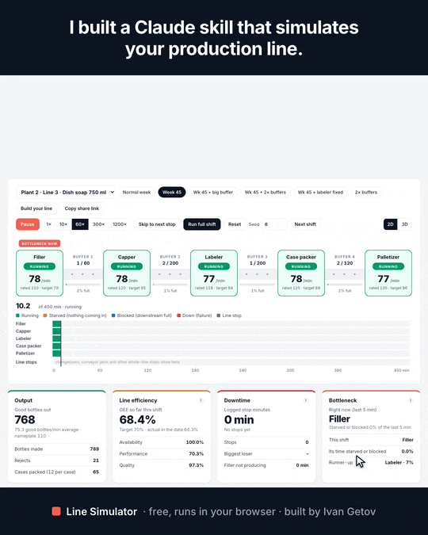

# Test the fix before you buy it: a free line simulator

**[▶ Try it live](https://ivanegetov-lab.github.io/line-sim/)**: free, runs in your browser, nothing to install, nothing uploaded.

A labeler starts jamming and the line loses 2,400 bottles a shift. Do you add more conveyor, or fix the jam? Watch what each fix gets back, then run the same test on your own line.



The [MP4 version](video/line-sim-demo.mp4) (1080×1350, for LinkedIn) is recorded from the real page by `node video/record.mjs`.

## The answer in 4 clicks

The page opens on Line 3 of [Plant 2](https://github.com/ivanegetov-lab/plant2-dataset), a fictional packaging plant with an open dataset (filler → capper → labeler → case packer → palletizer, 110 bottles/min). In week 45 new label stock made the labeler jam.

| Step | Good bottles per shift (200 simulated shifts) | What you see |
|---|---|---|
| 1. Normal week | 33,090 | The filler sets the pace and everything after it keeps up |
| 2. Week 45: new label stock | −2,416 | The labeler jams, the conveyor in front of it fills, and the filler stops |
| 3. Buy 10× more conveyor before the labeler | gets back 27% (+664) | By the second jam the big conveyor is already full. The labeler is barely faster than the filler, so it takes hours to drain |
| 4. Fix the label stock | gets back 100% (+2,416) | The line just runs |

**A buffer buys you time. It does not fix a machine that keeps stopping.**

## Run it on your own line

1. **Type in your line** (5 minutes, no data needed): machines in order, rated speeds, conveyor sizes, and roughly how often each one stops.
2. **Upload your downtime CSV** (10 minutes): any export with one row per stop. The stop rates are worked out in your browser.
3. **Use the free Claude skill** (messy data): give Claude your CMMS or MES export. It builds a simulator page for your line and lists every number it had to guess. See [Use it with Claude](#use-it-with-claude).

Then compare a bigger buffer, a faster machine or fewer stops, and send the result to your team with "Copy share link".

**What people use it for:**
- checking what a conveyor or a faster machine is worth before buying it;
- settling which machine is really the bottleneck;
- turning a downtime log into bottles a shift for a root-cause fix;
- training supervisors on starved, blocked and down.

## How it works

2 to 10 machines in series, with a conveyor or buffer between each pair. Machines stop as often and for as long as the downtime log says, and buffers fill and empty. It is one self-contained HTML page.

Data for the three built-in lines comes from the [Plant 2 open dataset](https://github.com/ivanegetov-lab/plant2-dataset) by Ivan Getov (a fictional plant, CC BY 4.0). Machine speeds and buffer sizes are design assumptions and are labelled as such on the page.

## Use it in a browser

Open `index.html`. On GitHub Pages the repo root serves it as is.

- **Run a shift.** Play, pause, 1× to 300×, or run the whole shift at once. Each machine shows running, starved, blocked or down; each buffer shows what it holds. The seed fixes the random stops, so the same seed gives the same shift.
- **2D / 3D.** The 3D view shows the same simulation state as a low-poly line with andon lights (green running, amber starved, blue blocked, red down), bottles on the conveyors and labels over each machine. Drag to rotate, pinch or ctrl+scroll to zoom. It loads three.js 0.160.0 from jsDelivr, the only external script; with no WebGL or no network the page stays in 2D.
- **Compare scenarios.** 200 shifts per scenario by default (30 or 1,000 optional), average with a P10–P90 range, all on the same random stops.
- **Skip to next stop.** Jumps to 30 seconds before the next stop and plays it at 10×, so you don't sit through quiet hours. If the shift has no more stops, it goes to the next shift. 1200× runs a whole shift in about 22 seconds.
- **The answer in 4 clicks.** On Line 3, each step loads a scenario and jumps to the moment worth watching (just before a labeler jam).
- **Build your line.** Add, remove, reorder and rename machines; edit speeds, stop rates and buffers. Import a downtime CSV (pick the columns, map each cause to a machine), import or export the config as JSON, or copy a share link that carries the whole line in the URL.
- **Check the numbers.** The last section of the page lists simulated against real stop rates, the method and every assumption.

Built-in lines: Plant 2 Line 3 (default), Line 1 and Line 2. Fixed views for screenshots: `index.html?line=plant2-line1&sc=dbl&seed=45&t=236&play=1&view=3d` (`line` preset id, `sc` scenario id, `t` minutes already run, `view` 2d or 3d, `reps` shifts per scenario).

The Inter font loads from Google Fonts; the page works without it.

## Use it with Claude

`skill/line-sim/` is a Claude skill that builds this page for somebody's own line. Copy the folder into your skills directory (for Claude Code: `~/.claude/skills/line-sim/`), then ask Claude something like "build a simulator of our line from this downtime export". Claude will:

1. read the downtime and production exports (CSV or Excel), or interview you about the line: machines in order, rated speeds, conveyor sizes;
2. run `scripts/derive_params.py` with the column mapping, which writes `config.json`;
3. run `scripts/build.py config.json --out my-line.html`, which embeds the config in a copy of the simulator;
4. tell you which numbers came from data and which are assumptions.

The scripts also work without Claude:

```bash
cd skill/line-sim/scripts
python3 derive_params.py --downtime downtime.csv --cause-col cause --minutes-col minutes \
    --date-col date --shift-col shift --filter line="Line 1" --list-causes        # see what is in the file
python3 derive_params.py --downtime downtime.csv --cause-col cause --minutes-col minutes \
    --date-col date --shift-col shift --filter line="Line 1" \
    --production production.csv --prod-filter line="Line 1" --planned-col planned_min --run-col run_min \
    --total-col total_count --good-col good_count --rate-col ideal_rate_per_min \
    --machine "Filler=Filler faults:100" --machine "Capper=Capper faults:109" \
    --machine "Labeler=Labeler jams:107" --machine "Case packer=Case packer faults:114" \
    --machine "Palletizer=:123" --buffers 50,180,180,110 \
    --line-stop "Changeover=Changeovers@start" --line-stop "Other line stops=Material short|Other" \
    --conveyor "Conveyor" --name "Line 1" --unit bottles --out config.json
python3 build.py config.json --out my-line.html
node check.mjs config.json          # optional: 200 shifts without a browser, against the real figures
```

Python 3.8+ standard library. Excel input needs `openpyxl`. `check.mjs` needs Node 18+.

## Config schema (`line-sim/1`)

One JSON object per line. Used by Import/Export JSON, share links, `build.py` and the files in `presets/`. Full reference with every optional field: [`skill/line-sim/references/config-schema.md`](skill/line-sim/references/config-schema.md).

```json
{
  "name": "Jar line B",
  "product": "Pasta sauce 500 g",
  "unit": "jars",
  "shift_min": 480,
  "run_speed_factor": 0.85,
  "reject_rate": 0.01,
  "machines": [
    { "name": "Filler",  "rated_speed": 200, "mtbs_min": 90,  "stop_mean_min": 4 },
    { "name": "Capper",  "rated_speed": 220, "mtbs_min": 240, "stop_mean_min": 6 },
    { "name": "Labeler", "rated_speed": 230, "stops_per_hour": 1, "stop_mean_min": 3, "stop_spread": 0.8 }
  ],
  "buffers": [ { "capacity": 150 }, { "capacity": 400 } ],
  "line_stops": [
    { "name": "Changeover", "kind": "shift_start", "prob_per_shift": 0.3, "stop_mean_min": 35, "stop_spread": 0.2 },
    { "name": "Material short", "kind": "random", "mtbs_min": 1500, "stop_mean_min": 20 }
  ]
}
```

| Field | Meaning |
|---|---|
| `name`, `product`, `unit` | Labels. `unit` is what the line makes (bottles, cans, parts). |
| `shift_min` | Planned production minutes per shift (10–1440). One run is one shift. |
| `run_speed_factor` | Share of rated speed the line really makes between logged stops (0.05–1). Applied to every machine. |
| `reject_rate` | Share of finished units rejected (0–0.9). |
| `ideal_rate` | Nameplate line rate per minute that OEE is measured against. Default: the slowest machine. |
| `machines[]` | 2 to 10, in line order. `name`, `rated_speed` (units/min), then stops: `stops_per_hour` **or** `mtbs_min` (mean running minutes between stops), `stop_mean_min` (average stop), `stop_spread` (lognormal sigma, default 0.5; 0.3 = stops close to average, 1.0 = a few very long ones). |
| `buffers[]` | One fewer than machines. `capacity` in units; `buffers[i]` sits after machine `i`. |
| `line_stops[]` | Stops of the whole line. `kind: "random"` with a rate like a machine, or `kind: "shift_start"` with `prob_per_shift` (changeovers). |
| `conveyor_stops` | Optional. Same stop fields; each stop lands on one conveyor at random. |
| `scenarios[]`, `reference`, `assumptions[]`, `notes[]`, `source` | Optional: your own what-ifs, real figures to compare against, and text shown on the page. |

Missing values get defaults, out-of-range values are clamped, unknown keys are kept. `build.py` refuses a config with real errors (no speed, wrong number of buffers) and says what is wrong.

## Method

**From a downtime log to stop rates** (`derive_params.py`; the in-browser CSV import does the same sums and is tested against it):

- running minutes = shifts covered × planned minutes − all downtime minutes
- stops per hour = stops of a source ÷ running minutes × 60
- mean stop = average logged minutes; spread = standard deviation of ln(minutes)
- changeovers: probability per shift = changeovers ÷ shifts, placed at the start of the shift
- run-speed factor = units made ÷ Σ(ideal rate × running minutes); reject rate = 1 − good ÷ made

**The engine** (in `index.html`, `<script id="engine">`, no DOM, about 300 lines):

- One-second steps, whole units. A machine makes `rated_speed × run_speed_factor`, limited by the buffer before it (starved) and the space after it (blocked). Unused capacity is lost, not banked.
- Time to the next stop is exponential and the clock runs only while the machine is working. Stop length is lognormal with the given mean and spread.
- Buffers have capacity and no travel time. Machines hold no product.
- Each stop source has its own random stream, so every scenario sees the same stops and differences come from the settings alone.
- Bottleneck = the machine with the least time starved or blocked; near-ties go to the one furthest downstream.
- OEE = good units ÷ (ideal rate × planned minutes).

More detail: [`skill/line-sim/references/method.md`](skill/line-sim/references/method.md).

### Start-up of an empty line

Every shift starts with an empty line. A unit moves one machine per one-second step, so the first unit reaches the end after (machines − 1) seconds, and that much of the slowest machine's output never leaves the line in the shift:

> output with no stops = slowest rate × (shift − (machines − 1) seconds)

For Line 3 that is 4 s × 110/60 = 7 bottles out of 49,500. For an 8-machine can line at 520/min it is 7 s × 8.67 = 61 cans out of 374,400 (0.016%). The shortfall is the same for a 1-hour and a 24-hour shift, and every unit that went in is either out or in a buffer. The tests check output against this formula to within 2 units, not against rate × time with a loose tolerance. A real line takes longer than this to prime, because product also has to travel along the conveyors; the model has no travel time.

## Results for the built-in lines

Plant 2 Line 3, 200 shifts per scenario (seeds 45000–45199); 3,000-shift averages in brackets:

| Scenario | Good bottles / shift | P10–P90 | OEE | vs normal week | Bottleneck |
|---|---|---|---|---|---|
| Normal week | 33,090 (32,969) | 30,681–34,790 | 66.8% | – | Filler |
| Week 45 (label stock) | 30,674 (30,388) | 27,524–34,173 | 62.0% | −2,416 (−2,581) | Labeler |
| Week 45 + 10× buffer before the labeler | 31,338 (31,094) | 28,242–34,173 | 63.3% | −1,752 (−1,875) | Filler |
| Week 45 + double every buffer | 30,903 (30,636) | 27,858–34,173 | 62.4% | −2,187 (−2,334) | Filler / Labeler |
| Week 45 + labeler fixed | 33,090 (32,969) | 30,681–34,790 | 66.8% | 0 | Filler |
| Normal week + double every buffer | 33,182 (33,082) | 30,778–34,790 | 67.0% | +92 (+113) | Filler |

Real data: 32,830 good bottles per shift in a normal week (simulated 3,000-shift average is 0.4% above), 29,020 in week 45.

A ten times bigger buffer in front of the labeler gets back about a quarter of what week 45 cost. Fixing the label stock gets back all of it. A buffer only helps if the machine after it can catch up, and the labeler runs only 5.7 bottles/min faster than the filler.

Lines 1 and 2 (generic what-ifs, 200 shifts):

| | Line 1 · cleaner 1 L | Line 2 · softener 500 ml |
|---|---|---|
| Real data, good / shift | 29,629 (OEE 65.8%) | 40,702 (OEE 64.6%) |
| As set up | 29,838 (66.3%) | 41,549 (66.0%) |
| Double every buffer | +69 | +115 |
| Halve the stops on the worst machine | +191 (filler) | +193 (case packer) |
| Fix that machine completely | +388 | +361 |
| Slowest machine 10% faster | +2,106 | +2,944 |
| No stops at all | +1,676 | +2,515 |

## Assumptions

For the Plant 2 presets:

- **Rated speeds are not in the dataset.** They follow a V-curve on the line rate (Line 3: filler 110, capper 120, labeler 118, case packer 125, palletizer 135 per minute). Which machine is the bottleneck, and what a buffer is worth, depend on them.
- **Buffer sizes are not in the dataset** (Line 3: 60, 200, 200, 120 bottles).
- **Run-speed factor** (Line 3: 70.9%). Between logged stops the real line makes that share of nameplate. The log does not say where the loss sits, so every machine is slowed by the same factor.
- Conveyor stops are logged against the whole conveyor system, so each lands on one conveyor at random.
- Changeovers happen at the start of a shift. Material short, Other, and Waiting on maintenance with no asset stop the whole line at a random time. Waiting on maintenance booked to an asset counts as a stop of that machine.
- The palletizer has no logged stops in 13 weeks, so it never stops.
- Week 45 scenarios change only the labeler (stops and reject rate). The real week 45 also ran slower between stops (66.3% against 70.9%); that drop was there before the first jam, so the simulator does not blame the labeler for it. This is why simulated week 45 (30,400–30,700) is above the real 29,020. With the logged speed and only the logged stops the simulation gives 29,376 (test 6b).
- Line 2 runs two sizes. The preset is the 500 ml size (140/min); stop rates come from all Line 2 shifts.

For your own line the page lists whatever `derive_params.py` had to assume (speeds, buffers, shift count, run-speed factor) under "Data, method and assumptions".

## Limits

- Serial lines only. No parallel machines, rework loops, batch steps or splits and merges. A parallel group can be entered as one machine with the combined speed.
- Buffers have no travel time and machines hold no product, so short lines react faster than real ones and start-up is quicker (see above).
- Stops are independent of each other and of the time of day. No shared operators, no waiting for a fitter who is busy elsewhere, no planned maintenance, no speed that changes with buffer level.
- Speed loss is one factor for the whole line. If one machine is slow in reality, set its rated speed instead.
- Stop statistics from a few dozen stops are rough. A machine with 25 stops in 12 weeks has a rate known to about ±20% (one standard error).
- Simulated logged downtime is within about 10% of the data on the three presets (Line 3 +1%, Line 1 −5%, Line 2 −10%), and simulated output is 0.4% to 2.1% above the data. Stops that run past the end of a shift are cut off, and a starved or blocked machine does not move towards its next stop; both pull simulated downtime down a little.
- The 3D view draws at most a few hundred bottles per conveyor and shows fill level, not individual units.
- It is a way to compare options under stated numbers. It is not a forecast.

## Checks

```bash
node test_sim.mjs               # 28 engine and tool checks (CSV checks need ../plant2-dataset)
node test_skill.mjs             # 16 end-to-end skill checks on Line 1 and Line 2 (needs python3 and ../plant2-dataset)
node screenshots/shoot.mjs      # 28 screenshots plus console-error and share-link checks (needs puppeteer; path at the top of the script)
```

| Check | Result |
|---|---|
| Line 3, no stops: 450 × 110 less start-up = 49,492.7 | 49,492 out; in 49,499 = out + 7 in buffers |
| Line 3, one machine slowed (90, 80, 100, 60/min): slowest rate × time less start-up | 40,494 · 35,994 · 44,993 · 26,996, each within 1 unit; bottleneck method names the slow machine each time |
| 3-machine line, 480 min, 30/min slowest: 14,399 | 14,398 |
| 8-machine line, 720 min, 520/min slowest: 374,400 − 60.7 start-up = 374,339.3 | 374,339 |
| Same at 80% run speed: 299,520 − 48.5 = 299,471.5 | 299,472 |
| 8-machine shortfall for 1 h, 4 h, 12 h, 24 h shifts | −61, −61, −61, −61 (start-up, not a rate error) |
| 2-machine line at 0.4/min with a buffer of 3, 600 min: 240 | 240 |
| Conservation: units in = out + in buffers; buffers within 0..capacity; state times add up to the shift | 0 violations in 4,449,600 one-second steps (Line 3 normal, week 45 and a harsh variant; 3-, 8- and 10-machine lines with heavy failures) |
| Same seed, same shift | yes |
| Line 3 normal week, 3,000 shifts: stops per shift and mean stop of every source within 10% of data | yes; logged downtime 25.7 vs 25.41 min/shift |
| Line 3 normal week output vs data | 32,969 vs 32,830 (+0.42%); OEE 66.6% vs 66.3% |
| Week 45 "as logged" reproduces the week | 29,376 vs 29,020 good per shift |
| Config: normalize is idempotent; export → import → export is byte-identical; presets on disk = presets in the page | yes |
| Share link: encode → decode gives the same config and the same shift | yes; also in the browser: 8-machine line, 343,880 out and 29 stops before and after reopening the link |
| In-browser CSV maths = `derive_params.py`, Line 3 weeks 33–44 | all 7 sources identical to the last digit; run minutes 75,153 |
| Skill end to end, Line 1 and Line 2 (`derive_params.py` → `build.py`) | stop rates, run-speed factor, reject rate and 200-shift results identical to the presets; Excel input gives the same config as CSV |
| The 4-step story on the page quotes the 200-shift results | yes |
| Browser: 2D, 3D, phone width, editor, CSV import, 4-step story, skill-built page | no console errors or warnings; no horizontal overflow at 390 px; falls back to 2D without WebGL |
| Speed | 200 shifts of Line 3 in about 0.3 s |

## Files

| Path | What it is |
|---|---|
| `index.html` | The simulator. Self-contained; this is what GitHub Pages serves. |
| `presets/plant2-line{1,2,3}.json` | The three built-in lines as config files. |
| `skill/line-sim/` | The Claude skill: `SKILL.md`, `scripts/derive_params.py`, `scripts/build.py`, `scripts/check.mjs`, `references/`, and `assets/simulator.html` (a copy of `index.html`). |
| `derive_params.py` | Rebuilds the three presets from the Plant 2 dataset and embeds them in `index.html`. Uses the skill's `derive_params.py` for the stop statistics. |
| `test_sim.mjs`, `test_skill.mjs` | The checks above. |
| `screenshots/` | Layout screenshots and `shoot.mjs`, which retakes them. |
| `.build/`, `build_page.sh` | The page in parts and the script that joins them. Edit the parts, run `sh build_page.sh`, then the tests. |

## License

Code: MIT, see [LICENSE](LICENSE). Plant 2 dataset: CC BY 4.0, Ivan Getov.
